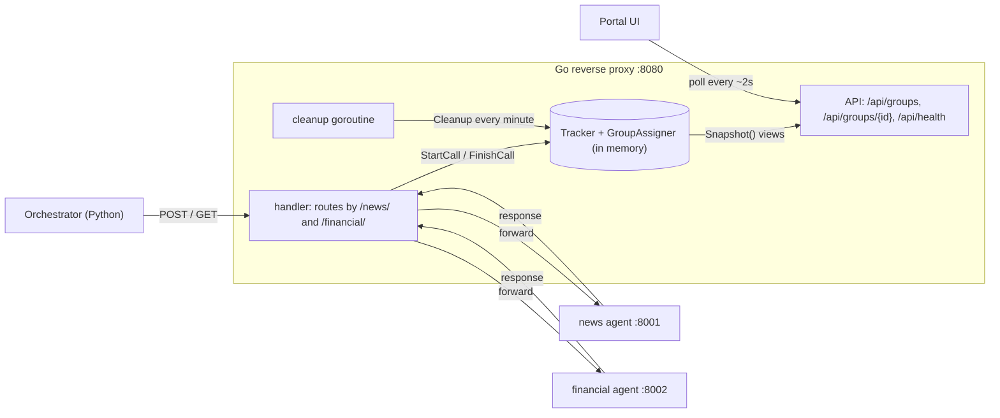

# Proxy API architecture

How the Go reverse proxy records agent calls (the write side) and serves them to the portal UI (the read side).

## Diagram



<details>
<summary>Plain-text version (for viewers that don't render Mermaid)</summary>

```
                       WRITE SIDE (per request)
┌──────────────┐   POST/GET    ┌────────────────────────────────┐   forwards   ┌────────────┐
│ Orchestrator │ ────────────▶ │  handler  (route by /news/..)  │ ───────────▶ │ news :8001 │
│  (Python)    │ ◀──────────── │                                │ ◀─────────── │ financial  │
└──────────────┘   response    │  1. assigner.Begin → groupID   │   response   │   :8002    │
                               │  2. tracker.StartCall          │              └────────────┘
                               │  3. ModifyResponse/ErrorHandler│
                               │     → tracker.FinishCall       │
                               └───────────────┬────────────────┘
                                               │ writes (under lock)
                                               ▼
                               ┌────────────────────────────────┐
                               │ Tracker.groups                 │◀─── cleanup goroutine
                               │ (GroupRecord → CallRecord)     │     (every minute, removes
                               │ GroupAssigner.byClient         │      old groups/clients)
                               └───────────────┬────────────────┘
                                               │ Snapshot() copies into views
                                               ▼
                       READ SIDE (new API)
┌──────────────┐   GET         ┌────────────────────────────────┐
│  Portal UI   │ ────────────▶ │ /api/groups          (list)    │
│ (polls every │ ◀──────────── │ /api/groups/{id}     (one)     │
│  2 seconds)  │   JSON        │ /api/health                    │
└──────────────┘               │  → CORS wrapper → GroupView[]  │
                               └────────────────────────────────┘
```

</details>

## How to read it

1. **The orchestrator never knows about the tracker.** It talks to `/news/` and `/financial/` on the proxy as if they were the agents.
2. **Each request writes to the tracker.** `handler` assigns a group (`assigner.Begin`), starts a call (`tracker.StartCall`), and finishes it when the response or error comes back (`ModifyResponse` / `ErrorHandler` → `tracker.FinishCall`).
3. **The tracker holds the only copy of the data.** A cleanup goroutine started in `main` trims old groups and idle clients on a timer.
4. **The API only reads.** Every endpoint calls `Snapshot()`, which copies the records into `GroupView` / `CallView` values under the lock. The UI never sees live records.
5. **The UI polls.** It calls `/api/groups` every few seconds. A processing call's `duration_ms` grows on each poll.

## Endpoints

| Endpoint | Returns |
|---|---|
| `GET /api/groups` | Groups, newest first. Optional `?status=failed` and `?limit=50`. |
| `GET /api/groups/{id}` | One group with its calls, or 404. |
| `GET /api/health` | `{"status":"ok"}` |
| `GET /debug/requests` | Alias of the full list, kept for now. |

## Records vs views

| | Tracker records | Output views |
|---|---|---|
| Types | `GroupRecord`, `CallRecord` | `GroupView`, `CallView` |
| Job | Internal state the proxy updates | The JSON shape the UI reads |
| Time | `StartedAt` / `EndedAt` | `started_at`, `ended_at`, computed `duration_ms` |
| Group status | Not stored | Derived from the calls |
| Thread safety | Guarded by `t.mu` | Copies, safe to encode |

## What changes to build the API

- Three `mux.HandleFunc` registrations in `main` (plus `/debug/requests` as an alias).
- One handler per endpoint that filters the snapshot and encodes JSON.
- A small CORS wrapper around them, if the UI runs on another port.
- Nothing on the write side changes.
